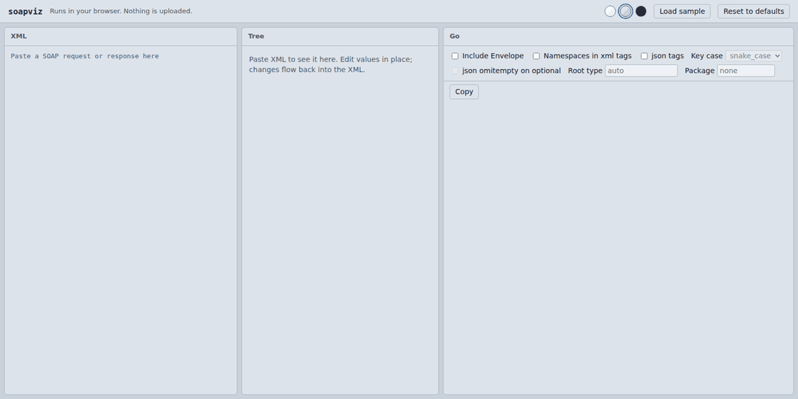
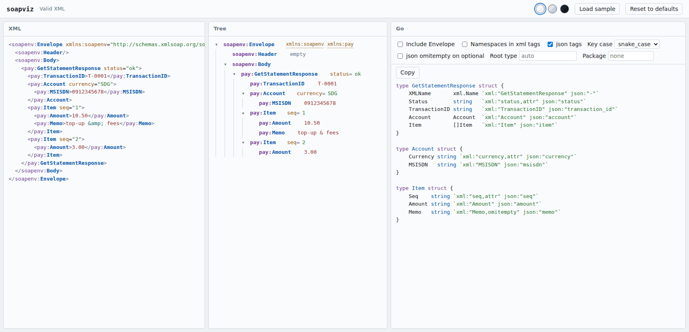
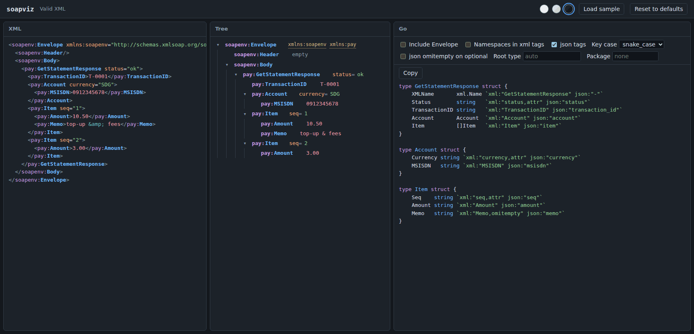
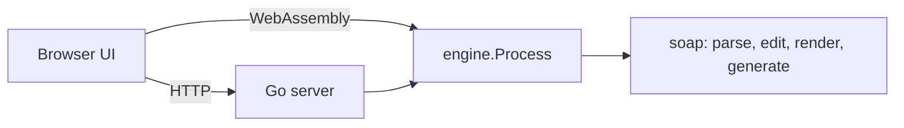

<h1 align="center">soapviz</h1>

<p align="center">
  Paste a SOAP request or response, edit it as a tree, and get Go structs with <code>xml</code> and <code>json</code> tags.
</p>

<p align="center">
  <a href="https://gatogato999.github.io/soapviz/"></a>
  <a href="https://github.com/gatogato999/soapviz/actions/workflows/pages.yml"></a>
  
  <a href="LICENSE"></a>
</p>

<p align="center">
  
</p>

**[Try it in your browser](https://gatogato999.github.io/soapviz/).** It runs entirely client-side as WebAssembly, so nothing you paste is uploaded anywhere.

## Why

Reading a SOAP payload as one long line of XML is slow, and hand-writing the Go structs for it is tedious and error-prone. soapviz does both jobs in one place:

- **See it.** Namespaces, prefixes, attributes and text get their own colors, in an editable tree next to the raw XML.
- **Change it.** Edit values, attributes and names in the tree. Duplicate or delete elements. The XML updates as you go.
- **Generate it.** Get Go structs with `xml` tags, and optional `json` tags in snake_case or camelCase.

## Features

- Editable tree and syntax-highlighted XML, kept in sync both ways
- Go struct generation that merges every occurrence of an element, so repeated elements become slices and elements missing from some occurrences become optional
- Strips `Envelope`/`Body` by default; one checkbox keeps them
- Inline mode: one named root type with every nested element as an anonymous struct inside it, instead of a separate type per element
- `json` tags: as written, snake_case or camelCase, with optional `omitempty`
- Optional namespace URIs in `xml` tags, custom root type name, optional `package` clause
- Light, dim and dark themes; draggable, keyboard-resizable panes
- Your theme, options and pane widths are saved in your own browser
- Runs three ways: in the browser (WebAssembly), as a local Go binary, or as a shared server for a team

## Example

Input (the payload inside a SOAP `Body`):

```xml
<pay:GetStatementResponse status="ok">
  <pay:TransactionID>T-0001</pay:TransactionID>
  <pay:Account currency="SDG">
    <pay:MSISDN>0912345678</pay:MSISDN>
  </pay:Account>
  <pay:Item seq="1">
    <pay:Amount>10.50</pay:Amount>
    <pay:Memo>top-up</pay:Memo>
  </pay:Item>
  <pay:Item seq="2">
    <pay:Amount>3.00</pay:Amount>
  </pay:Item>
</pay:GetStatementResponse>
```

Output, with json tags in snake_case:

```go
type GetStatementResponse struct {
	XMLName       xml.Name `xml:"GetStatementResponse" json:"-"`
	Status        string   `xml:"status,attr" json:"status"`
	TransactionID string   `xml:"TransactionID" json:"transaction_id"`
	Account       Account  `xml:"Account" json:"account"`
	Item          []Item   `xml:"Item" json:"item"`
}

type Account struct {
	Currency string `xml:"currency,attr" json:"currency"`
	MSISDN   string `xml:"MSISDN" json:"msisdn"`
}

type Item struct {
	Seq    string `xml:"seq,attr" json:"seq"`
	Amount string `xml:"Amount" json:"amount"`
	Memo   string `xml:"Memo,omitempty" json:"memo"`
}
```

`Item` is a slice because it repeats, and `Memo` gets `omitempty` because only one of the two items has it.

### Inline mode

Turn on **Inline nested structs** (or `inline = true` in the config) to get one type with the nesting written out, which suits one-off decoding where you do not want a type per element:

```go
type GetStatementResponse struct {
	XMLName       xml.Name `xml:"GetStatementResponse"`
	Status        string   `xml:"status,attr"`
	TransactionID string   `xml:"TransactionID"`
	Account       struct {
		Currency string `xml:"currency,attr"`
		MSISDN   string `xml:"MSISDN"`
	} `xml:"Account"`
	Item []struct {
		Seq    string `xml:"seq,attr"`
		Amount string `xml:"Amount"`
		Memo   string `xml:"Memo,omitempty"`
	} `xml:"Item"`
}
```

Nothing is shared between places in this mode, so the same shape that appears twice is written out twice.

## Themes

<table>
  <tr>
    <td></td>
    <td></td>
  </tr>
</table>

## Run it locally

With Go 1.22 or newer:

```sh
go install github.com/gatogato999/soapviz/cmd/soapviz@latest
soapviz                       # http://127.0.0.1:8484
```

or from a clone:

```sh
git clone https://github.com/gatogato999/soapviz
cd soapviz
go run ./cmd/soapviz
```

The browser is not opened automatically. Use `-open` if you want that.

### Configuration

Copy [`config-example.ini`](config-example.ini) to `config.ini` to change defaults. Every key is optional, and a typo is a startup error, not a silent fallback.

| Section | Keys |
|---|---|
| `[server]` | `listen`, `open_browser`, `max_body_mb` |
| `[ui]` | `theme` (`light`, `dim`, `dark`) |
| `[generator]` | `include_envelope`, `namespaces`, `json`, `json_case`, `omit_empty`, `inline`, `root`, `package` |

The file is read from `-config`, else `./config.ini`, else next to the binary. The flags `-addr` and `-open` override it.

### Sharing one instance with a team

Set `listen = 0.0.0.0:8484`. The server keeps no per-user state: theme, options and pane widths live in each developer's own browser, and `config.ini` only provides the starting defaults. **There is no authentication**, so only expose it on a network you trust.

## Generator rules

| Input | Go |
|---|---|
| Element that repeats under one parent | `[]T` |
| Element missing from some occurrences | `omitempty`; a pointer if it is a struct |
| Element with no attributes or children | `string` (values are never guessed as numbers or booleans, so `0912345678` stays a string) |
| Element with attributes and text | struct with a `Value` field tagged `,chardata` |
| Same element name, different shape in two places | second one becomes `ParentName`, then numbered (not applicable in inline mode) |
| Names like `transaction_id`, `TransactionID`, `MSISDN` | `TransactionID`, `TransactionID`, `MSISDN` |

Namespaces go into `xml` tags only when you ask for them. Without them, unmarshaling matches on the local name.

## How it works



| Path | Role |
|---|---|
| `soap/` | Core: parse, edit, render, generate. Standard library only. |
| `engine/` | One request/response function over the core, plus the Go highlighter. |
| `web/` | HTTP server and the embedded UI. Stateless. |
| `cmd/soapviz` | The server. |
| `cmd/wasm` | The same engine compiled to WebAssembly for the static site. |
| `config/` | `config.ini` parser. |

The UI is the same code in both modes. It calls `api/process` on the server, or the WebAssembly module on the static site. Build the static site yourself with `scripts/build-pages.sh`; pushes to `main` deploy it through [GitHub Actions](.github/workflows/pages.yml).

## Limits

- Comments, processing instructions and the `<?xml?>` declaration are dropped when the XML is re-rendered.
- Whitespace around text is trimmed.
- Types are not inferred. Everything is a `string`.
- A single sample cannot show that a field is optional. Paste several items or responses for better results.

## Development

```sh
go test ./...
GOOS=js GOARCH=wasm go vet ./cmd/wasm
scripts/build-pages.sh /tmp/site     # then serve /tmp/site with any static file server
```

## License

[MIT](LICENSE)
